<div align="center">


<br>

### Plain-English tax reforms in. Verified, evidence-backed forecasts out.

Jane Avenue is an AI-powered UK fiscal policy simulator for HM Treasury, HMRC and OBR analysts.<br>
**Gemini researches. NumPy calculates. An independent verifier decides whether you see a forecast at all.**

<br>

[](https://github.com/Infosuii/Jane-Avenue/actions/workflows/ci.yml)
[](#testing)
[](#how-it-works)
[](LICENSE)

[](https://www.python.org/)
[](https://fastapi.tiangolo.com/)
[](https://numpy.org/)
[](https://docs.pydantic.dev/)
[](https://ai.google.dev/)
[](https://react.dev/)
[](https://www.typescriptlang.org/)
[](https://tailwindcss.com/)
[](https://vite.dev/)
[](https://playwright.dev/)

<p>
  <a href="#quickstart"><b>Quickstart</b></a> ·
  <a href="#how-it-works"><b>How it works</b></a> ·
  <a href="#a-tour-of-the-app"><b>Tour</b></a> ·
  <a href="#the-golden-path"><b>Results</b></a> ·
  <a href="#evaluation-backtesting-and-honest-ml"><b>Evaluation</b></a> ·
  <a href="#documentation"><b>Docs</b></a>
</p>

<br>

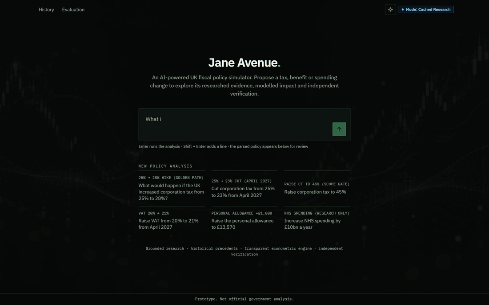

<sub>The golden path in cached mode: a query is parsed, researched, simulated, verified and written up in about five seconds.</sub>

</div>

<br>

## Why Jane Avenue

Ask a general-purpose chatbot *“What happens if the UK raises corporation tax from 25% to 28%?”* and you get confident, plausible and **unverifiable** £bn figures. Ask a Treasury spreadsheet and you get transparent arithmetic that misses the context, for example how April 2023's 100% *Full Expensing* changed the investment channel. Jane Avenue combines the strengths of both and adds a referee.

<table>
<tr>
<th></th>
<th>Strength</th>
<th>Failure mode for policy analysts</th>
</tr>
<tr>
<td><b>General-purpose chatbots</b></td>
<td>Fast prose synthesis</td>
<td>Invent £bn figures, fabricate URLs, and conflate ex-ante costings with observed receipts</td>
</tr>
<tr>
<td><b>Static spreadsheets</b></td>
<td>Transparent arithmetic</td>
<td>Miss institutional confounders and hide parameter uncertainty behind single point estimates</td>
</tr>
<tr>
<td><b>Jane&nbsp;Avenue</b></td>
<td colspan="2"><b>Grounded AI research + structural econometrics + independent verification.</b> Gemini never calculates a number. NumPy engines compute every projection, Python verifies every quote against fetched documents, and an 18-check verifier blocks unsupported forecasts.</td>
</tr>
</table>

## Highlights

<table>
<tr>
<td width="33%" valign="top">

**🔎 Grounded research agent**<br>
<sub>An autonomous Gemini agent searches and fetches only official sources (gov.uk, OBR, ONS, IFS, Parliament). Every quantitative quote is checked **verbatim** in Python against a SHA-256 snapshot of the document it came from.</sub>

</td>
<td width="33%" valign="top">

**📐 Transparent econometrics**<br>
<sub>A pure-NumPy structural model: static, behavioural and dynamic revenue; a Hall–Jorgenson user cost of capital across three asset classes; and Devereux–Griffith EMTR/EATR. Deterministic, with no I/O and no LLM.</sub>

</td>
<td width="33%" valign="top">

**🎲 Honest uncertainty**<br>
<sub>A 2,000-draw Monte Carlo with yearly profit-base shocks, so the uncertainty widens with the horizon. Tornado sensitivity and live assumption sliders re-simulate in milliseconds.</sub>

</td>
</tr>
<tr>
<td valign="top">

**🛡️ Independent 18-check verifier**<br>
<sub>Recomputes the engine to within 1e-9, audits citations, evidence, assumptions, data placeholders, causal wording and every digit in the report. If a blocking check fails, it sets <code>forecast_withheld</code>.</sub>

</td>
<td valign="top">

**🏛️ 40 years of precedent**<br>
<sub>16 UK corporation tax reforms (1983–2023), 1,736 wider fiscal reforms, 6,928 Treasury scorecard costings and 1,164 ONS/OBR outturns. Official costings are kept strictly separate from observed outcomes.</sub>

</td>
<td valign="top">

**🧾 Every number has a receipt**<br>
<sub>Each figure is labelled as an observed outcome, official costing, model scenario, assumption or AI interpretation, and links back to its calculation step, quote or dataset row.</sub>

</td>
</tr>
</table>

## How it works

<div align="center">
</div>

<details>
<summary><b>Stage-by-stage detail</b></summary>

<br>

| # | Stage | Where | What happens |
|:-:|---|---|---|
| 1 | **Parse & scope gate** | [`policy/`](backend/jane_avenue/policy/) | Natural language becomes a typed `PolicySpec` (contract v1.2.0). Every parser default and ambiguity is shown as an editable field before anything runs. The gate rejects negative rates, non-UK taxes, devolved rates and steps beyond historical bounds. |
| 2 | **Grounded research** | [`research/`](backend/jane_avenue/research/), [`llm/`](backend/jane_avenue/llm/) | Uses the `google-genai` Interactions API (`gemini-3.8-flash` / `gemini-4-argon`, `store=False`) with Google Search grounding and official URL fetches. Conflicting evidence is shown, not averaged away. |
| 3 | **Precedents** | [`precedents/`](backend/jane_avenue/precedents/), [`data/`](data/) | Weighted similarity: direction 0.30, magnitude 0.25, rate level 0.15, macro z-score 0.20, recency 0.10. Ex-ante costings (OBR/HMT) are kept separate from ex-post outcomes (ONS/HMRC). |
| 4 | **Simulate** | [`engine/`](backend/jane_avenue/engine/), [`simulation/`](backend/jane_avenue/simulation/) | Corporation tax structural engine (`engine-1.0.0`) and HMRC ready-reckoner engine (`reckoner-1.0.0`). Central, optimistic and pessimistic scenarios, a 2,000-draw Monte Carlo and a tornado, in under 30 ms. |
| 5 | **Verify** | [`verification/`](backend/jane_avenue/verification/) | `SCOPE`, `CITE-001..003`, `EVID-001..004`, `ASSUMP-001..002`, `CALC-001`, `DATA-001..002`, `CAUSAL-001`, `UNC-001`, `REPORT-001`. Any blocking failure sets `forecast_withheld`. |
| 6 | **Report** | [`report/`](backend/jane_avenue/report/) | Gemini drafts neutral analyst prose with `{{fig:id}}` placeholders. Python substitutes every figure from the engine and checks that no raw number was invented. |

</details>

<details>
<summary><b>The Full-Expensing Neutrality Theorem</b> (why the investment channel isn't where you'd expect)</summary>

<br>

Under a 100% first-year capital allowance ($z = 1$), the Hall–Jorgenson user cost of capital

$$c_a(t) = \frac{(r + \delta_a)(1 - t \cdot z_a)}{1 - t}$$

simplifies to $r + \delta_a$. Covered plant and machinery investment is therefore **invariant to the statutory CT rate at the margin**. The investment drag works through structures ($z = 0.299$, 3% SBA) and intangibles ($z = 0.720$) instead. A spreadsheet that applies one elasticity to all investment gets this wrong.

</details>

## A tour of the app

<table>
<tr>
<td width="50%">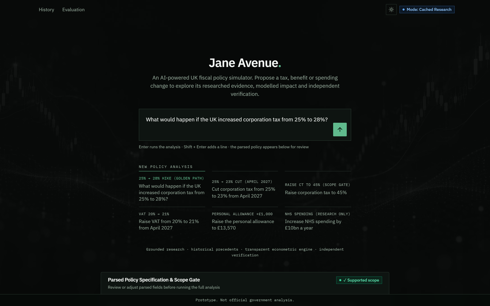<br><sub><b>Ask in plain English.</b> A search-first landing page with curated example prompts, including ones that deliberately trip the scope gate.</sub></td>
<td width="50%">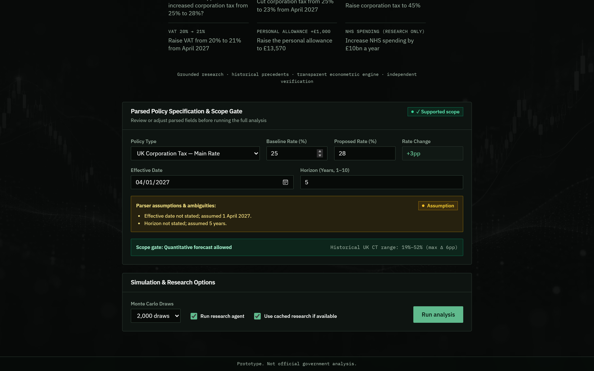<br><sub><b>Review before you run.</b> Parser defaults and ambiguities are shown as editable fields, and the scope gate's verdict appears before anything executes.</sub></td>
</tr>
<tr>
<td>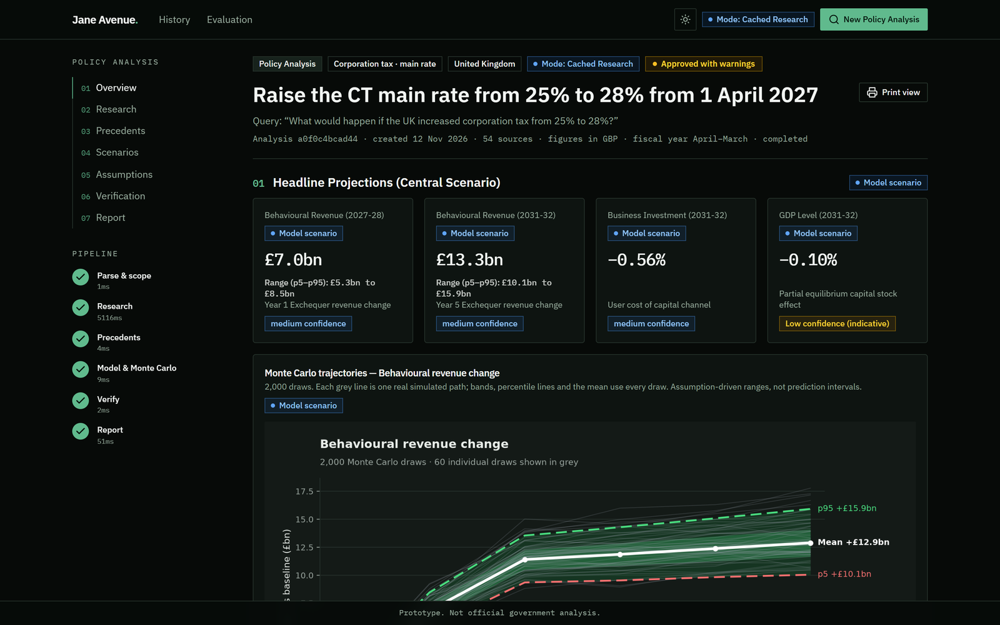<br><sub><b>Headline projections.</b> Each figure carries its evidence class, p5–p95 range and confidence level.</sub></td>
<td>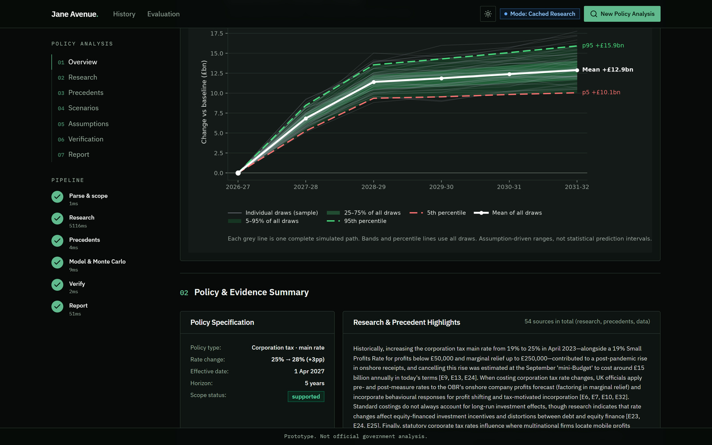<br><sub><b>Real Monte Carlo draws.</b> Every grey line is one simulated path. The bands, percentiles and mean use all 2,000 draws.</sub></td>
</tr>
<tr>
<td>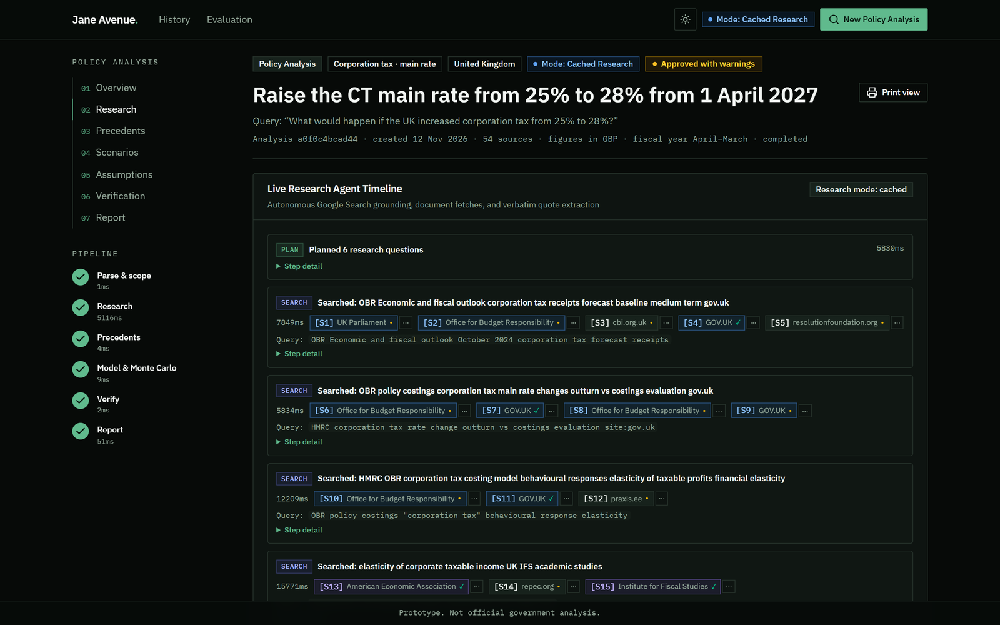<br><sub><b>Live research timeline.</b> Watch the agent plan, search, fetch and extract quotes. Every source is a numbered, checkable citation.</sub></td>
<td>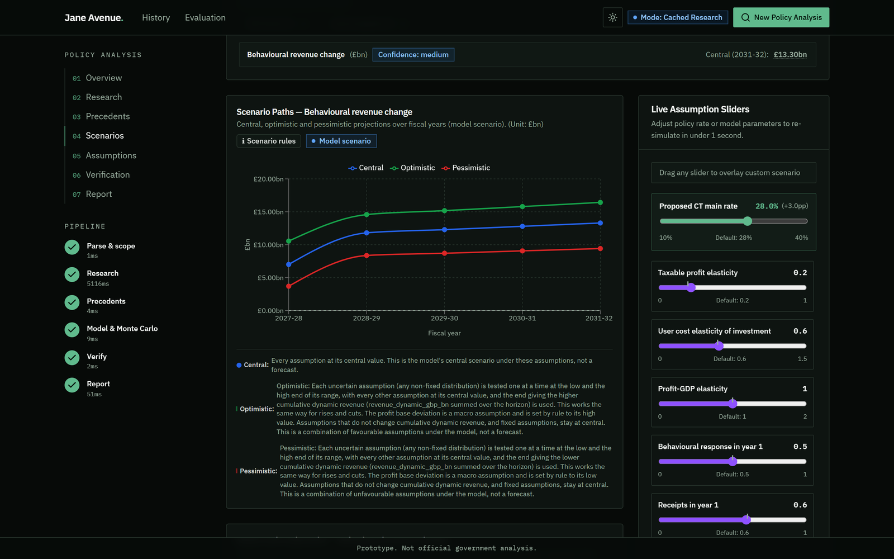<br><sub><b>Scenarios and live sliders.</b> Drag any of the 19 structural assumptions and re-simulate in under a second.</sub></td>
</tr>
<tr>
<td>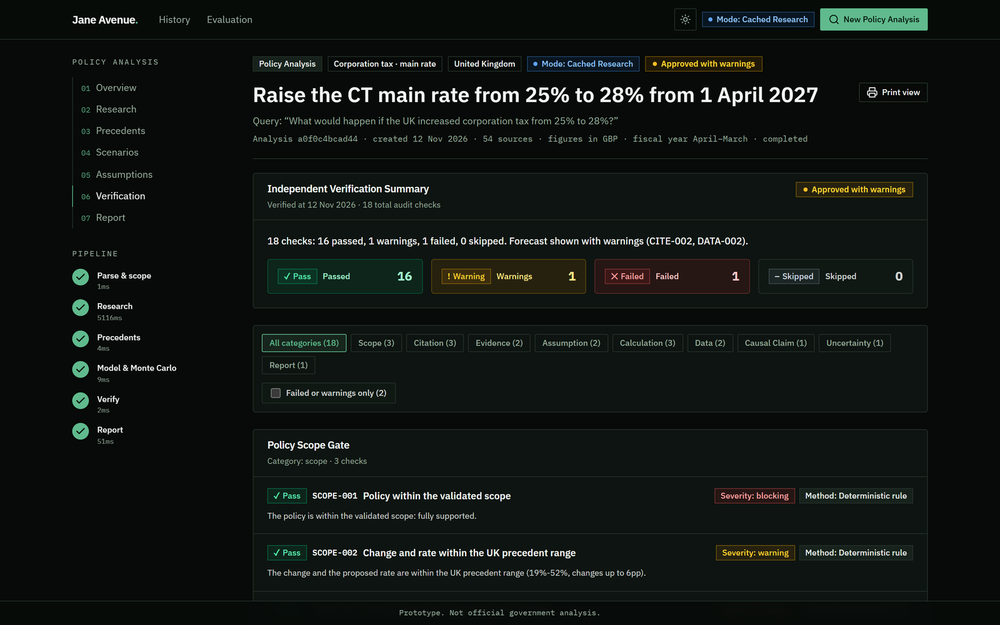<br><sub><b>Independent verification.</b> 18 audit checks, each with its severity and method. Warnings are shown, never hidden.</sub></td>
<td>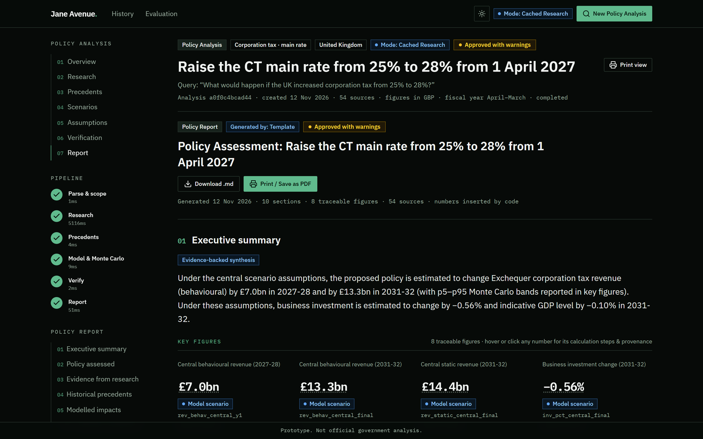<br><sub><b>Publication-grade report.</b> Numbered sections, traceable key figures and a source directory. Exports to Markdown or PDF.</sub></td>
</tr>
<tr>
<td>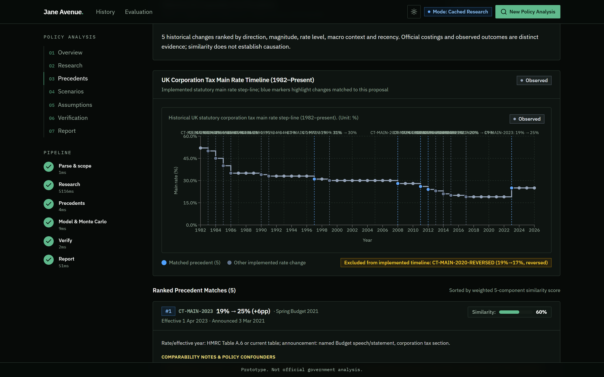<br><sub><b>Historical precedents.</b> UK corporation tax main rate since 1982, with matched reforms ranked by a five-component similarity score.</sub></td>
<td>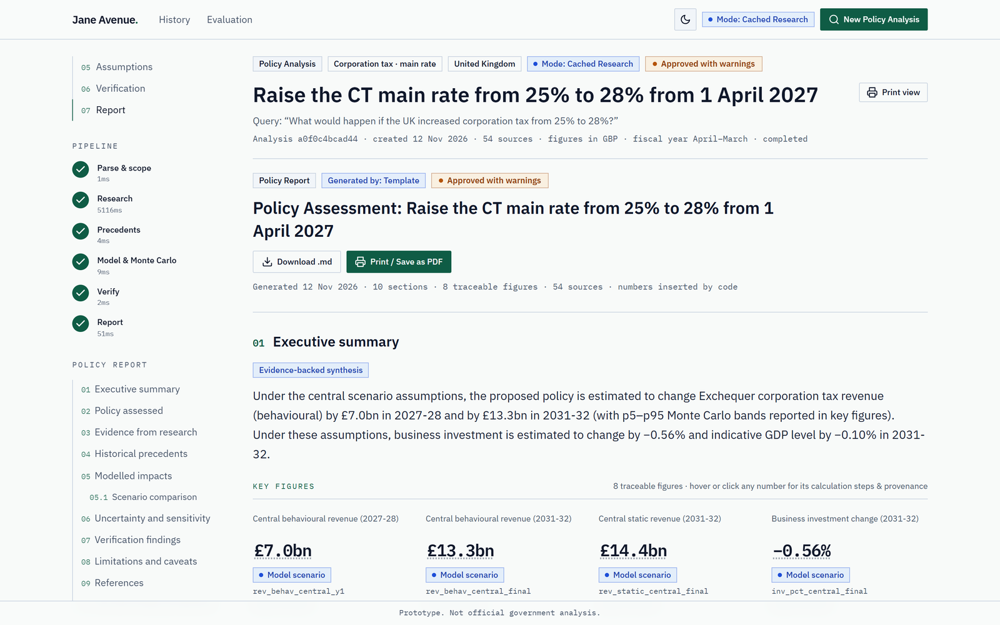<br><sub><b>Light and dark themes</b>, plus a print stylesheet built for ink.</sub></td>
</tr>
</table>

## The golden path

> **Query:** *“What would happen if the UK increased corporation tax from 25% to 28%?”*: 25% → 28% from April 2027, 5-year horizon, against the **OBR October 2026 EFO** baseline.

| Metric (central scenario) | Year 1 · 2027-28 | Year 5 · 2031-32 |
|---|--:|--:|
| Static revenue | **+£7.28bn** | **+£14.39bn** |
| Behavioural revenue (ε = 0.20) | **+£7.00bn** | **+£13.30bn** |
| Dynamic revenue | **+£6.99bn** | **+£13.16bn** |
| Business investment | −0.29% · −£1.00bn | −0.56% · −£2.19bn |
| Real GDP level | −0.016% | −0.104% |
| User cost of capital | +0.97% | EATR 21.7% → 24.3% |

<sub>Monte Carlo p5–p95 for Year 5 behavioural revenue: £10.1bn to £15.9bn. These are assumption-driven ranges, not prediction intervals.</sub>

## What it can model

<table>
<tr>
<td width="33%" valign="top">

#### 🟢 Full structural model
`engine-1.0.0`

UK corporation tax main rate and small profits rate. A multi-channel simulation over 1–10 fiscal years covering revenue, investment by asset, GDP and the cost of capital.

</td>
<td width="33%" valign="top">

#### 🔵 HMRC ready reckoner
`reckoner-1.0.0`

**17 tax and benefit measures**, reconciled to `1e-9` against 225 rows of HMRC's June 2025 costings: income tax rates and personal allowance, NICs, CGT (non-linear Laffer), IHT, VAT, IPT, fuel, alcohol and tobacco duties, and Child Benefit.

</td>
<td width="33%" valign="top">

#### 🟡 Guardrailed research
`fiscal_other`

Spending, the minimum wage, uncosted taxes, and extreme proposals such as *“Raise CT to 45%”*. These get full research and precedents, but `SCOPE-001` **withholds the number**.

</td>
</tr>
</table>

## Evaluation, backtesting and honest ML

Every metric is reproducible offline with `python -m jane_avenue.evaluation.run` and can be viewed in the app at `/evaluation`.

<div align="center">

| | Result |
|---|---|
| 📉 **Out-of-sample CT backtest** (train FY1983–2007, test FY2008–2024, *n* = 17) | **£5.54bn MAE** (9.36% MAPE). Beats static £5.71bn, naive growth £6.56bn and linear regression £8.35bn |
| 🎯 **Empirical interval coverage** (leave-one-out 90%) | **14 / 17** (82.3%) of unseen post-2008 outcomes |
| 🏛️ **External HMRC calibration** (+1pp CT) | Within **3.6%** in Year 2 and **1.0%** in Year 3 of HMRC's June 2025 ready reckoner |
| 📚 **Research agent** (15-question benchmark) | **15 / 15** factual accuracy · **15 / 15** valid URLs · **15 / 15** verbatim quotes · **0** hallucinated sources |
| 🛡️ **Verifier fault injection** | **18 / 18** faults detected · **0%** clean-case false positives |

</div>

> [!IMPORTANT]
> **ML honesty rule.** A regularised LightGBM challenger reached a lower *in-sample* MAE (£3.27bn), but degraded to **£6.33bn out-of-sample** (+93%), because 24 annual observations cannot support tree extrapolation across post-2008 regime shifts. It was therefore **transparently rejected (`adopted = False`)** and is not wired into the live simulator.

<div align="center">
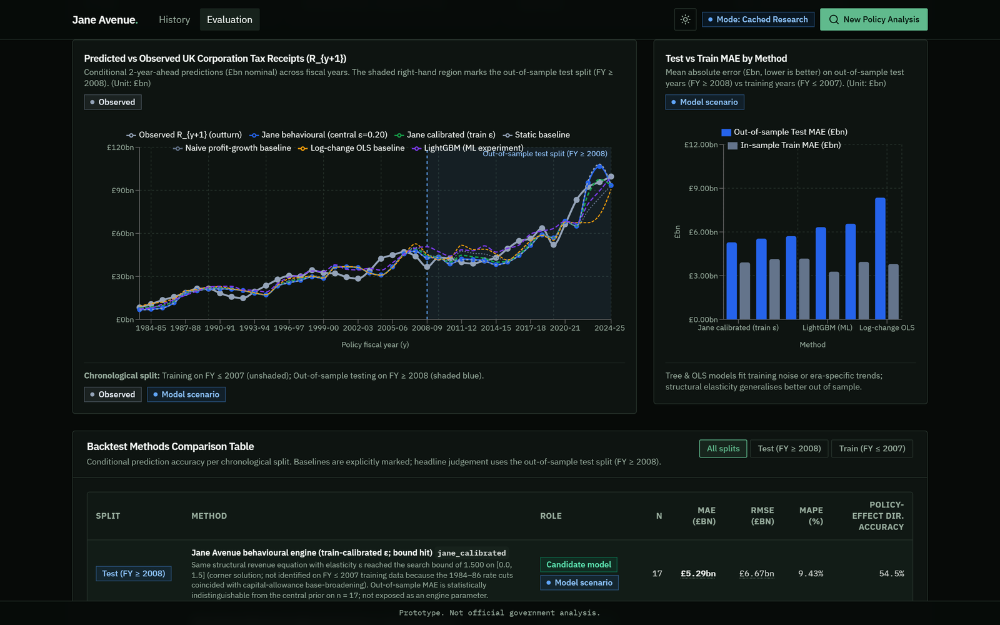
</div>

See [docs/EVALUATION.md](docs/EVALUATION.md) and [docs/HMRC_CALIBRATION_AND_STRESS_TEST.md](docs/HMRC_CALIBRATION_AND_STRESS_TEST.md) for the full reports.

## Trust and governance

- **On-device by default.** The engines, Monte Carlo, verifier and SQLite store run 100% locally.
- **Minimal cloud boundary.** In `live` mode only the parsed policy query goes to Gemini, with `store=False`, so no prompts or user data are retained.
- **Human in the loop.** Analysts can override every parsed parameter, adjust all 19 structural assumptions, and audit every check and source snapshot before export.
- **No invented data.** Anything unverified is marked `is_placeholder=True`, and the verifier surfaces it.

## Quickstart

> **Prerequisites:** Python 3.13 · Node.js 22+ · Git

```bash
git clone https://github.com/Infosuii/Jane-Avenue.git
cd Jane-Avenue
cp .env.example .env            # Windows: Copy-Item .env.example .env
```

Then start the backend (`:8000`) and frontend (`:5173`) with one command. It creates `.venv` and installs everything on first run:

```bash
JANE_MODE=cached ./scripts/dev.sh          # macOS / Linux
```

```powershell
$env:JANE_MODE = "cached"; .\scripts\dev.ps1   # Windows PowerShell
```

Open **http://localhost:5173**. The API docs are at http://localhost:8000/docs.

<table>
<tr><th>Mode</th><th>Needs</th><th>What you get</th></tr>
<tr><td><code>cached</code> ⭐</td><td>Nothing</td><td>Replays committed, SHA-256-verified live Gemini traces (golden path, a cut, a small hike and a guardrail refusal) in about 5 s. Best for demos. Falls back <code>live → cache → mock</code>.</td></tr>
<tr><td><code>mock</code></td><td>Nothing</td><td>The full pipeline with real data and the real engine against deterministic research fixtures, in under 1 s. This is what CI uses.</td></tr>
<tr><td><code>live</code></td><td><code>GEMINI_API_KEY</code></td><td>Real-time Gemini Interactions API with Google Search grounding and official document fetches.</td></tr>
</table>

<sub>If <code>JANE_MODE</code> is unset, it is detected automatically: <code>live</code> when <code>GEMINI_API_KEY</code> is set in <code>.env</code>, otherwise <code>mock</code>.</sub>

<details>
<summary><b>Run the backend and frontend in separate terminals</b></summary>

<br>

```powershell
# one-time setup
py -3.13 -m venv .venv
.\.venv\Scripts\Activate.ps1          # macOS/Linux: source .venv/bin/activate
pip install -r backend/requirements-dev.txt
cd frontend; npm ci; cd ..
```

```powershell
# terminal 1: API on :8000
$env:PYTHONPATH = "backend"
python -m uvicorn jane_avenue.api.app:app --reload --port 8000
```

```bash
# terminal 1 on macOS / Linux
PYTHONPATH=backend ./.venv/bin/python -m uvicorn jane_avenue.api.app:app --reload --port 8000
```

```bash
# terminal 2: UI on :5173
cd frontend && npm run dev
```

</details>

## Testing

**423** backend tests, **58** frontend tests and **4** end-to-end browser flows, all run in deterministic mock mode with no secrets.

| What | Command |
|---|---|
| Full CI suite: ruff, pytest, tsc, eslint, vitest, vite build and OpenAPI drift check | `./scripts/check.sh` · `.\scripts\check.ps1` |
| Golden-path smoke test with timings | `python backend/scripts/smoke.py --mode cached --json --expect-approved --max-seconds 20` |
| Backtest, ML experiment and evaluation report | `PYTHONPATH=backend python -m jane_avenue.evaluation.run` |
| HMRC calibration and stress suite | `pytest backend/tests/evaluation/test_hmrc_calibration_and_stress.py -v` |
| Playwright E2E (stop the dev servers first) | `cd e2e && npm ci && npx playwright install --with-deps chromium && npx playwright test` |
| Rebuild curated datasets | `python data/scripts/build_all.py --offline` |
| Regenerate OpenAPI types | `python backend/scripts/export_openapi.py && cd frontend && npm run gen:api` |

## Tech stack

| Layer | Technology |
|---|---|
| **Modelling** | Python 3.13 · NumPy · pandas · SciPy · statsmodels · LightGBM (evaluated, rejected) · Matplotlib |
| **API** | FastAPI · Pydantic v2 frozen contracts · Server-Sent Events · SQLite · rate limiting |
| **AI** | Google Gemini via `google-genai` Interactions API · Google Search grounding · `store=False` |
| **Frontend** | React 19 · Vite · TypeScript · Tailwind v4 · TanStack Query · React Router · Recharts · OpenAPI-generated types |
| **Quality** | pytest · ruff · Vitest · ESLint · Playwright · GitHub Actions |

<details>
<summary><b>Repository layout</b></summary>

<br>

```text
Jane-Avenue/
├── backend/jane_avenue/
│   ├── api/            FastAPI app, REST routes, SSE event stream, rate limiter
│   ├── charts/         Server-rendered Matplotlib Monte Carlo trajectory charts
│   ├── contracts/      Frozen Pydantic v2 data contracts (v1.2.0)
│   ├── data/           Curated dataset loader and provenance registry
│   ├── engine/         Pure-NumPy CT structural model and HMRC ready reckoner
│   ├── evaluation/     Chronological backtest, LightGBM challenger, citation and verifier evals
│   ├── llm/            Gemini Interactions API gateway
│   ├── orchestrator/   Six-stage pipeline coordinator
│   ├── policy/         Natural-language parser, 17-measure matcher, scope gate
│   ├── precedents/     Historical CT and wider fiscal precedent similarity
│   ├── report/         Template and Gemini narrative generator with {{fig:id}} substitution
│   ├── research/       Autonomous research loop, quote verifier, SHA-256 cache
│   ├── simulation/     Scenarios, 2,000-draw Monte Carlo, tornado
│   ├── store/          Thread-safe SQLite repository
│   └── verification/   Independent 18-check verification engine
├── data/
│   ├── curated/        Official ONS / OBR / HMRC datasets with .meta.json provenance
│   ├── research_cache/ Committed SHA-256-verified Gemini traces for cached mode
│   └── scripts/        Reproducible fetch-and-build pipelines
├── frontend/src/       React app: api, app shell, charts, features (10 views)
├── e2e/                Playwright end-to-end suite
├── docs/               Architecture, evaluation, data, UI, demo and runbook
└── scripts/            dev.sh / dev.ps1 and check.sh / check.ps1
```

</details>

## Documentation

| | |
|---|---|
| 🧭 [Architecture notes & model card](docs/ARCHITECTURE_NOTES.md) | 📊 [Evaluation report](docs/EVALUATION.md) |
| 🏛️ [HMRC calibration & stress tests](docs/HMRC_CALIBRATION_AND_STRESS_TEST.md) | 🗂️ [Data provenance](docs/DATA.md) |
| 🎨 [UI & design system](docs/UI.md) | 🎬 [4-minute demo script](docs/DEMO.md) |
| 🛠️ [Operations runbook](docs/RUNBOOK.md) | 🎤 [Pitch notes](docs/PITCH_NOTES.md) |
| 📘 [Full build specification](docs/MASTER_PROMPT.md) | 🤝 [Contributing](CONTRIBUTING.md) |

## Built by a team of AI agents

Jane Avenue was built by **eleven coordinated AI agents** using Claude Code, OpenAI Codex and Google Antigravity, with no central orchestrator. Each agent owned a workstream and a set of paths, and all coordination happened through GitHub Issues, reviews and **49 merged pull requests**, under a written protocol: [AGENTS.md](AGENTS.md) · [PROJECT.md](PROJECT.md) · [agent prompts](docs/prompts/).

<br>

<div align="center">

**[MIT License](LICENSE)** · <sub>Prototype built for fiscal policy analysis evaluation. Not official HM Treasury, HMRC or OBR analysis.</sub>

</div>
